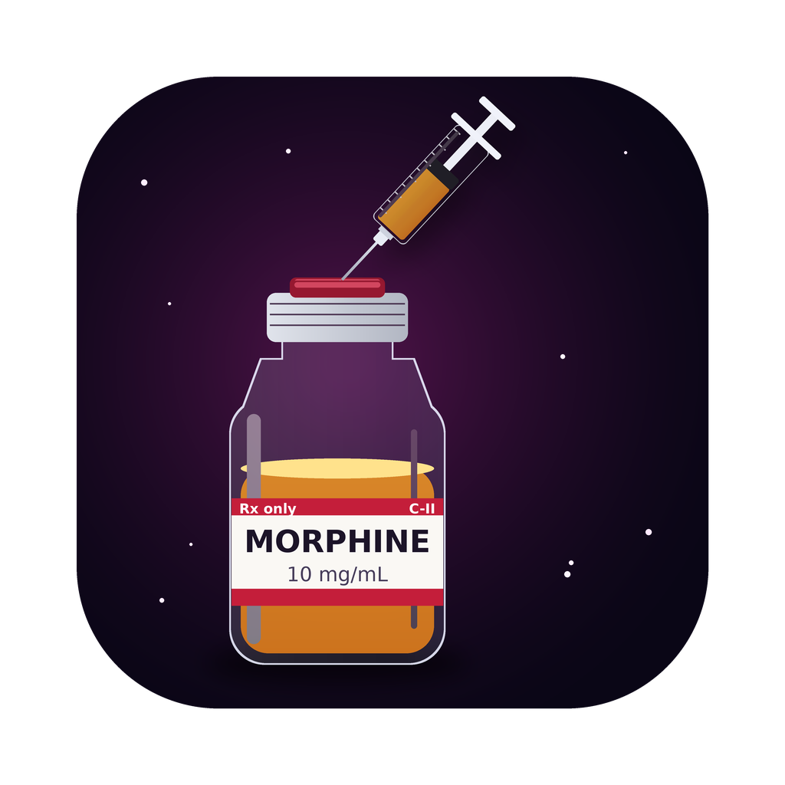
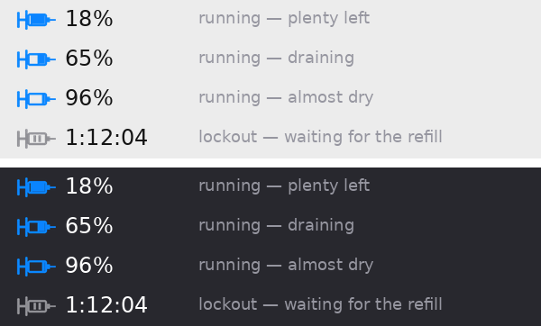

<p align="center">
  
</p>

<h1 align="center">Morphine</h1>

<p align="center">
  <b>Amphetamine keeps your Mac awake. Morphine puts your AI agent under until its usage refills.</b><br>
  When the 5-hour or weekly usage window is nearly drained, Morphine pauses the agent (spending <b>zero tokens</b> while it waits),<br>
  checks back every 31 minutes, and wakes it as soon as the window has refilled. Works with Claude Code, Codex, Gemini CLI and Grok Build.
</p>

<p align="center"><a href="#english">English</a> · <a href="#한국어">한국어</a></p>

---

## 한국어

### 이게 뭔가요

- **바닥나기 전에 멈춤:** 에이전트가 일하는 도중 5시간 한도나 주간 한도의 남은 양이 **5% 아래**로 떨어지면 (기준은 바꿀 수 있어요), 다음 도구 호출 직전에 그 자리에서 멈춰요.
- **대기 중 토큰 0:** 멈춘 동안 모델을 한 번도 부르지 않아요. 훅 프로세스가 기다리면서 사용량만 확인해요.
- **31분마다 확인 → 차면 자동 재개:** 멈춘 동안 31분마다 남은 양을 다시 확인해요. 리셋 시각을 알면 그 시각에도 한 번 더 확인하고, 다시 차 있으면 멈췄던 작업을 그대로 이어서 해요.
- **절약 모드:** 남은 양이 **50% 아래**로 내려가면 (기준은 바꿀 수 있어요) Claude Code·Codex에 "토큰을 아껴서 일해 달라"는 메모를 자동으로 넣어요. 다시 차면 메모로 해제해요.
- **메뉴바 표시:** 도구마다 남은 양을 보여줘요. 작동 중엔 **파란색**, 대기 중엔 **회색**이에요.

이름은 병원의 **모르핀 PCA 펌프**에서 왔어요. 버튼을 누르면 한 번 투여되고, 그다음엔 **잠금 시간(lockout)** 동안 아무리 눌러도 안 나와요.

<p align="center"></p>

### 지원 범위

| 도구 | 남은 양 읽는 곳 | 자동 멈춤 |
|---|---|---|
| **Claude Code** | Claude Code status line → Anthropic 사용량 서버 | ✅ 5시간·주간 (Claude Code 세션) |
| **Codex** | `codex app-server` → Codex 대화 기록 | ✅ 5시간·주간 (도구 호출·새 프롬프트를 거절해서 멈춤, 아래 설명) |
| **Gemini CLI** | 대화 기록으로 하루 요청 수 **추정** | ⚠️ 추정치라 기본은 표시만 |
| **Grok Build** | 공개된 사용량 정보 없음 | ❌ 한도에 걸린 뒤 감지 → 31분마다 재시도 |

- **사용량을 못 읽으면 절대 막지 않아요.** 그 도구는 항상 통과시켜요.
- **사용량은 계정 전체 기준이에요.** Claude 앱과 Claude Code, Codex 앱과 Codex CLI는 같은 요금제 한도를 같이 써서, 메뉴바 숫자에는 다 합쳐서 반영돼요.

### 설치

**요구사항:** macOS 13 이상, `python3` 3.9 이상 (macOS 기본 탑재), Xcode Command Line Tools (`xcode-select --install`, 메뉴바 앱 빌드용).

아래 명령을 터미널에서 한 줄씩 실행하세요.

```bash
git clone https://github.com/Voyager466920/morphine.git
cd morphine
./install.sh
```

- **메뉴바 앱:** `/Applications/Morphine.app`에 설치되고 바로 실행돼요.
- **CLI:** `morphine` 명령이 `~/.local/bin/morphine`에 생겨요. `command not found`가 나오면 `~/.zshrc`에 `export PATH="$HOME/.local/bin:$PATH"`를 추가하세요.
- **훅:** 이 Mac에서 찾은 도구(Claude Code, Codex, Gemini CLI, Grok)에 자동으로 연결돼요. 특정 도구만 연결하려면 `./install.sh claude codex`처럼 이름을 붙이세요.

**업데이트:** 저장소 폴더에서 `git pull` 후 `app/scripts/bundle.sh --install`을 실행하세요.

### 도구 연결하기

**Claude**

Claude Code 로그인이 필요해요. Claude 앱만 쓰더라도 사용량을 읽을 때 이 로그인 정보를 써요.

```bash
curl -fsSL https://claude.ai/install.sh | bash
```

```bash
claude
```

1. 브라우저에서 로그인하세요.
2. "Claude Code-credentials" 키체인 접근 창이 뜨면 **항상 허용**을 누르세요.
3. 1분 안에 메뉴바에 Claude가 떠요.

Claude Code로 작업할 때 자동으로 멈추게 하려면 `morphine install claude`도 실행하세요. 기존 status line이 있으면 보존하고 뒤에 `💉 5h 18% left`만 붙여요.

**Codex**

Codex CLI가 있어야 훅을 **신뢰(trust)** 처리할 수 있어요. VS Code 확장에 들어 있는 `codex`로는 안 돼요.

```bash
brew install --cask codex
```

```bash
codex
```

1. Codex 안에서 `/hooks`를 입력하고 Morphine 훅 두 개를 신뢰 처리하세요.
2. 이걸 안 하면 Codex는 사용량 표시만 되고 멈추지 않아요.

**Codex는 멈추는 방식이 달라요.** Codex(앱·VS Code·CLI)는 30초 넘게 걸리는 훅을 끊고 그냥 진행해 버려서, Claude처럼 훅에서 기다리게 할 수가 없어요. 그래서 남은 양이 기준 아래로 떨어지면 Morphine이 **도구 호출을 거절**하고 "여기서 멈추고 턴을 끝내라"고 알려줘요. 새 프롬프트도 대기 중엔 거절돼요.

- **재개:** 31분마다 확인해서 다시 차면 알림이 와요. 앱·VS Code에서는 그때 "계속"이라고 보내면 이어서 해요.
- **완전 자동 재개 (CLI):** `~/.zshrc`에 `alias codex='morphine run --provider codex -- command codex'`를 추가하고 CLI로 쓰면, 다시 찼을 때 Morphine이 `continue`를 대신 입력해요.

Homebrew가 없으면 `npm install -g @openai/codex`로 설치하세요 (Node 22 이상 필요).

**Grok Build · Gemini CLI**

사용량 API가 없거나 추정치뿐이라 래퍼로 실행하세요. `~/.zshrc`에 추가하면 돼요.

```bash
alias grok='morphine run --provider grok -- command grok'
alias gemini='morphine run --provider gemini -- command gemini'
```

한도 메시지를 감지하면 31분마다(또는 화면에 나온 리셋 시각에) `continue`를 대신 입력해서 이어가요.

### 사용법

**메뉴바 읽는 법**

- **주사기 + 배지 + 숫자:** 도구마다 하나씩 보여요 (**C** Claude · **O** Codex · **G** Gemini · **X** Grok). 숫자는 그 도구의 **남은 양**이에요.
- **어떤 한도 기준인지:** 5시간 한도가 있으면 5시간 한도, 없으면 그다음 짧은 한도를 보여줘요.
- **회색 + 시간:** 그 도구가 대기 중이에요. 시간은 충전 예상까지 남은 시간이에요.
- **보이지 않는 도구:** 사용량을 읽을 수 없는 도구는 숨겨져요. 패널 아래 "연결 안 됨"에 이름이 나와요.
- **갱신 간격:** 내 컴퓨터 기록은 2초마다, 서버 조회는 1분마다 갱신돼요.

**메뉴바를 클릭하면 나오는 패널**

- **도구별 막대:** 5시간·주간 남은 양과 리셋 시각을 보여줘요.
- **대기 중인 도구:** 충전 예상 시각, 다음 확인 시각, **지금 바로 깨우기** 버튼이 나와요.
- **대기 시작 기준:** 1 / 2 / 3 / 5 / 10% 중에서 고를 수 있어요.
- **토글:** 대기 중 Mac 잠자기 방지, 메뉴바 % 표시, 모든 도구 표시(끄면 가장 급한 것만), 로그인 시 실행.
- **메뉴바 색:** 작동 중일 때 색을 고를 수 있어요. 파란색(기본), 파란색(배경에 맞춤), 연한 하늘색, 보라·초록·주황, 흰색/검정(메뉴바 글자색), 직접 선택. 대기 중은 항상 회색이에요.

**배지에 로고 넣기 (선택)**

Morphine은 다른 회사의 로고를 포함하지 않아요. 직접 구한 이미지를 아래처럼 넣으면, 1분 안에 글자 배지 대신 그 로고가 떠요. 배경이 투명한 PNG를 권장해요.

- `~/.morphine/icons/claude.png`
- `~/.morphine/icons/codex.png`
- `~/.morphine/icons/gemini.png`
- `~/.morphine/icons/grok.png`

**제대로 멈추는지 시험하기**

1. 지금 남은 양보다 높게 기준을 잠깐 올리세요. 예: Codex가 36% 남았다면 `morphine config set threshold_pct 40`.
2. 에이전트에 파일 읽기나 명령 실행이 들어가는 작업을 시키면, 그 자리에서 멈추고 메뉴바가 회색으로 바뀌어야 해요.
3. **먼저** `morphine config set threshold_pct 5`로 되돌리세요.
4. 그다음 **지금 바로 깨우기**를 누르면 이어서 진행돼요.

### 절약 모드

남은 양(메뉴바에 보이는 숫자)이 기준 아래로 내려가면, Morphine이 다음 프롬프트에 짧은 메모를 붙여서 에이전트가 토큰을 아끼게 해요. Claude Code와 Codex에서 동작해요.

**줄이는 것:**

- 인사말, 앞뒤 요약, 군더더기 문장 → 짧고 담백한 문장으로
- 파일 전체를 다시 보여주기 → 바뀐 부분만
- 같은 파일 다시 읽기, 긴 명령 출력 그대로 붙이기 → 필요한 범위만 읽고, 걸러서 보기
- 따로따로 하는 도구 호출 → 묶어서 한 번에

**줄이지 않는 것 (성능 유지):**

- 코드, 명령어, 오류 메시지, 숫자는 생략 없이 정확하게
- 생각(추론), 테스트, 검증은 평소만큼 꼼꼼하게

**알아둘 점:**

- **메모를 붙이는 시점:** 켜질 때 한 번, 그 뒤로는 15번 프롬프트마다 한 번만 다시 붙여요. 매번 붙이지 않아서 메모 자체에 드는 토큰은 아주 적어요.
- **꺼지는 시점:** 한도가 다시 차서 기준 위로 올라가면 "절약 모드 해제" 메모로 원래대로 돌아가요.
- **패널 표시:** 절약 모드가 켜진 도구 옆에 **절약 중**이 떠요.
- **기준 바꾸기:** 패널의 **절약 모드 시작**에서 끄기 / 20~70% 중에 고르거나, 아래 명령어로 바꿀 수 있어요.

### 명령어

| 하고 싶은 것 | 명령 |
|---|---|
| 모든 도구 사용량 보기 | `morphine status` |
| 서버에서 새로 읽기 | `morphine status --refresh` |
| 대기 기준 바꾸기 (남은 %, 기본 5) | `morphine config set threshold_pct 3` |
| 대기 중 확인 간격 바꾸기 (분, 기본 31) | `morphine config set recheck_min 31` |
| 리셋 시각 추가 확인 끄기 (31분 간격만) | `morphine config set recheck_at_reset false` |
| 5시간 한도만 보고 멈추기 | `morphine config set windows '["5h"]'` |
| 대기 중 잠자기 방지 끄기 | `morphine config set keep_awake false` |
| 절약 모드 기준 바꾸기 (남은 %, 기본 50) | `morphine config set economy.below_pct 40` |
| 절약 모드 끄기 | `morphine config set economy.enabled false` |
| 대기 중인 에이전트 모두 깨우기 | `morphine resume` |
| `codex` 경로 직접 지정 | `morphine config set providers.codex.path /path/to/codex` |
| 도구 훅 연결 | `morphine install claude codex gemini grok` |
| 모든 훅 제거 (백업 남김) | `morphine uninstall` |
| 현재 설정 보기 | `morphine config` |

설정 파일은 `~/.morphine/config.json`, 대기 기록은 `~/.morphine/log.txt`에 있어요.

### 알아둘 점

- **기준을 너무 낮추면 빠듯해요.** 훅은 도구 호출 직전에 확인하는데, 응답 한 번에 2~3%를 쓰는 경우도 있어서 기본값을 5%로 뒀어요.
- **기다리는 동안 에이전트 창을 닫지 마세요.** 닫으면 이어서 진행할 대상이 없어져요.
- **Mac 잠자기는 Morphine이 막아줘요.** 대기 중에는 `caffeinate -i`로 잠자기를 막아요. 다만 MacBook 덮개를 닫으면 잠들 수 있어요.
- **재개 직후 첫 호출은 조금 비싸요.** 오래 쉬면 프롬프트 캐시가 만료돼서, 재개 후 첫 호출에서 캐시를 다시 만들어요.
- **비공식 경로는 깨질 수 있어요.** Codex app-server와 Anthropic 사용량 서버 조회는 공식 문서에 없는 방법이에요. 업데이트로 바뀌면 그 도구만 "알 수 없음"이 되고, 에이전트를 막지는 않아요.
- **알림은 두 번만 와요.** 대기가 시작될 때 한 번, 다시 차서 재개될 때 한 번이에요. 확인은 도구별로 31분마다 한 번씩만 해요.
- **zsh에서 명령어 뒤 `# 설명`은 쓰지 마세요.** zsh 기본 설정에서는 주석으로 인식하지 않아서 오류가 나요.

---

## English

**What it does.** Morphine watches each agent's usage windows. When less than `threshold_pct` (default **5%**) of a 5-hour, weekly or daily window remains, the agent's own hook blocks right before the next tool call or prompt and holds it there. While it waits, Morphine re-reads usage every `recheck_min` minutes (default **31**, plus once at the reported reset time) and makes **no model calls**. As soon as the window has refilled, the hook returns and the agent carries on where it stopped.

**Economy mode.** Below `economy.below_pct` left (default **50%**), the UserPromptSubmit hook adds a short note for Claude Code and Codex: terse prose, no recaps, only changed lines, targeted file reads, filtered command output — while code, commands, numbers, reasoning, testing and verification stay as complete and thorough as usual. The note is added on the switch and every 15 prompts, and a second note turns it off when the window refills.

**Menu bar.** Each agent gets a syringe injecting into a badge (C Claude · O Codex · G Gemini · X Grok, or your own logo in `~/.morphine/icons/<agent>.png`). The number next to it is how much of its shortest window (5-hour, else daily, else weekly) is **left**: blue while it runs, gray with a countdown while it is locked out. Agents without usage data are hidden. Local readings refresh every 2 s, server readings every 60 s.

| Agent | Usage source | Auto-pause |
|---|---|---|
| Claude Code | status line `rate_limits` → Anthropic OAuth usage endpoint | ✅ 5h & weekly (Claude Code sessions) |
| Codex | `codex app-server` `account/rateLimits/read` → session logs | ✅ 5h & weekly — Codex kills hooks after ~30 s, so Morphine *denies* tool calls/prompts instead of sleeping; the agent ends its turn and is resumed on refill (automatically under `morphine run -- codex`) |
| Gemini CLI | estimated from session files | ⚠️ estimate, display-only by default |
| Grok Build | none published | ❌ PTY wrapper reacts to the limit message, retries every 31 min |

**Install**

```bash
git clone https://github.com/Voyager466920/morphine.git
cd morphine
./install.sh
```

**Connect your agents**

- **Claude:** install Claude Code (`curl -fsSL https://claude.ai/install.sh | bash`) and log in once with `claude`. Allow the Keychain prompt for "Claude Code-credentials". For auto-pause inside Claude Code, also run `morphine install claude`.
- **Codex:** install the Codex CLI (`brew install --cask codex`), open `codex`, run `/hooks` and trust the two Morphine hooks.
- **Grok / Gemini:** run them through the wrapper, e.g. `alias grok='morphine run --provider grok -- command grok'`.
- **Claude Code plugin:** `/plugin marketplace add Voyager466920/morphine`, then `/plugin install morphine@morphine`, then `morphine install claude --no-hooks` for the status line feed.

**Commands:** `morphine status`, `morphine config set threshold_pct 5`, `morphine config set recheck_min 31`, `morphine resume`, `morphine uninstall`. Settings live in `~/.morphine/config.json`.

**Design rules**

- **Unknown usage never blocks.** Adapter errors, timeouts and missing data always let the agent through.
- **One adapter per provider.** Each lives in `morphine/adapters/` and only answers "how much is used, when does it reset". `morphine/guard.py` makes the decision.
- **Shared state for the menu bar.** Lockouts are recorded in `~/.morphine/state.json`. `morphine resume` (or the app's **Wake now** button) ends them early.
- **No dependencies.** Standard-library Python 3.9+ and SwiftUI only.

**Development**

```bash
python3 -m unittest discover tests
app/scripts/bundle.sh
```

The test suite has 31 tests, including an end-to-end PTY wrapper run. The second command builds `dist/Morphine.app`.

### License

MIT © Voyager466920
